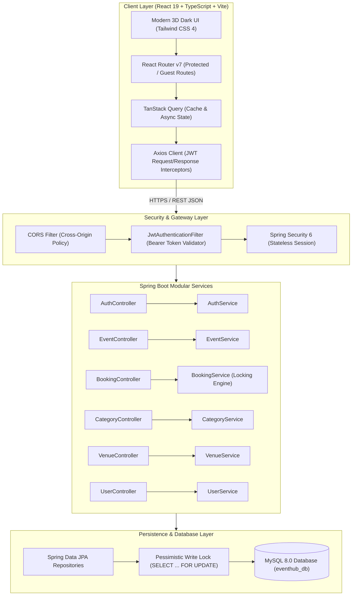
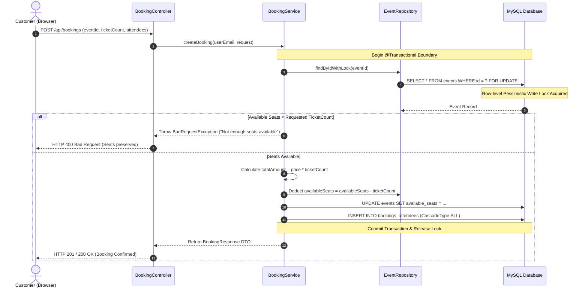
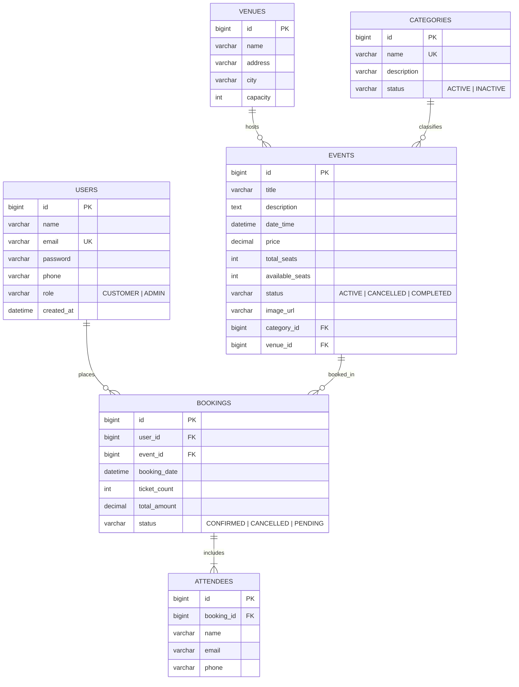

# EventHub (EMS) — Functional Specification & Technical Architecture Document

---

## 1. Executive Summary

**EventHub** is a production-grade, full-stack Event Management and Ticket Booking System designed for high-concurrency event discovery, seat reservation, and administrative event logistics. Built with a modern decoupled architecture, it pairs a **React 19 / TypeScript / Vite** frontend featuring a luxury dark 3D glassmorphic UI with a robust **Spring Boot 3.3.4 (Java 21) & MySQL** backend enforcing ACID compliance and pessimistic locking for seat allocation.

---

## 2. Technology Stack

### 2.1 Frontend Stack

| Technology | Version / Tool | Purpose |
|---|---|---|
| **Core Framework** | React 19.3.1 | Component-driven UI library |
| **Language** | TypeScript ~6.0.3 | Strict static typing, interfaces, and DTO contracts |
| **Bundler & Build Tool** | Vite 8.3.4 | Ultra-fast HMR and optimized Rolldown/ESBuild bundling |
| **Styling & Design System** | Tailwind CSS 4.3.3 (`@tailwindcss/vite`) | Utility-first CSS engine with bespoke CSS custom properties |
| **Routing** | React Router DOM 7.18.4 | Client-side routing, protected routes, and nested outlets |
| **Server State Management** | TanStack Query (React Query) 5.104.5 | Server-state caching, automatic cache invalidation, and retry policies |
| **HTTP Client** | Axios 1.20.0 | REST client with automated JWT Bearer interceptors & 401 response handling |
| **Iconography** | React Icons (`react-icons/hi2`) | Heroicons v2 vector graphics |
| **Code Splitting** | `React.lazy` & `Suspense` | Route-level code-splitting (chunk payload reduced from 501 kB to ~75 kB) |

### 2.2 Backend Stack

| Technology | Version / Tool | Purpose |
|---|---|---|
| **Runtime & JDK** | Java 21 (LTS) | Modern language features, Virtual Thread readiness, pattern matching |
| **Framework** | Spring Boot 3.3.4 | Enterprise application framework |
| **REST Layer** | Spring Web MVC | Controllers, request/response DTO serialization, HTTP status mapping |
| **Persistence / ORM** | Spring Data JPA & Hibernate 6.x | Entity mapping, repositories, automated schema validation |
| **Database** | MySQL 8.x (`mysql-connector-j`) | Relational transactional database engine |
| **Security Framework** | Spring Security 6.x | Stateless JWT filter chain, BCrypt password hashing, Method Security |
| **Token Engine** | JJWT (io.jsonwebtoken) 0.12.6 | HMAC-SHA256 JWT signature generation and claims validation |
| **Input Validation** | Hibernate Validator (`spring-boot-starter-validation`) | Declarative Jakarta Bean Validation (`@NotNull`, `@Size`, `@Email`) |
| **Boilerplate Reduction**| Project Lombok | `@Getter`, `@Setter`, `@Builder`, `@RequiredArgsConstructor` |
| **API Documentation** | SpringDoc OpenAPI 2.6.0 | Automated OpenAPI 3.0 specs and Swagger UI |
| **Testing Suite** | JUnit 5 & Mockito | Unit tests, concurrency simulations, and mock repositories |
| **Build Automation** | Maven 3.9+ with Maven Wrapper (`mvnw`) | Standardized reproducible enterprise builds |

---

## 3. High-Level Architecture Diagram



---

## 4. User Roles & Permission Matrix

| Module / Operation | Anonymous Guest | Customer | Administrator |
|---|:---:|:---:|:---:|
| **Browse Homepage & Discover Events** | ✅ Allowed | ✅ Allowed | ✅ Allowed |
| **Search, Filter & Sort Events** | ✅ Allowed | ✅ Allowed | ✅ Allowed |
| **View Event Details & Available Seats** | ✅ Allowed | ✅ Allowed | ✅ Allowed |
| **Register New Customer Account** | ✅ Allowed | ❌ Redirected | ❌ Redirected |
| **Login / Logout** | ✅ Allowed | ✅ Allowed | ✅ Allowed |
| **Book Event Tickets** | ❌ Requires Login | ✅ Allowed | ✅ Allowed |
| **View "My Bookings" & Ticket Detail** | ❌ Denied (401) | ✅ Own Bookings Only | ✅ Allowed |
| **Edit Customer Profile** | ❌ Denied (401) | ✅ Own Profile Only | ✅ Allowed |
| **Admin Dashboard (Live Metrics)** | ❌ Denied (403) | ❌ Denied (403) | ✅ Allowed |
| **Create, Update, Delete Events** | ❌ Denied (403) | ❌ Denied (403) | ✅ Allowed |
| **Manage Categories & Venues** | ❌ Denied (403) | ❌ Denied (403) | ✅ Allowed |
| **Manage All Bookings & Update Status**| ❌ Denied (403) | ❌ Denied (403) | ✅ Allowed |

---

## 5. Functional Module Specifications

### 5.1 Authentication & Security Module
- **Registration**:
  - Full name, valid email format, 6+ character password, and optional phone number.
  - Server verifies email uniqueness; throws HTTP `400 Bad Request` on duplicate submission.
  - Passwords hashed using **BCrypt** (10 salt rounds).
  - Assigned role defaults to `CUSTOMER`.
- **Login**:
  - Accepts email and password.
  - Validates credentials via `DaoAuthenticationProvider`.
  - Generates signed HMAC-SHA256 JWT containing subject (email), role claim, creation timestamp, and 24-hour expiration (`86,400,000 ms`).
  - Returns JWT token and sanitized User DTO (excluding password).
- **Session Management**:
  - Stateless server architecture.
  - Frontend stores token in `localStorage` under `eh_token` and user profile under `eh_user`.
  - Axios interceptor automatically attaches `Authorization: Bearer <token>` to all protected calls.
  - Global Axios response interceptor intercepts HTTP `401 Unauthorized`, clears local storage, and redirects to `/login`.

---

### 5.2 Event Discovery & Search Engine
- **Search Capabilities**:
  - Full-text case-insensitive keyword search matching event titles and descriptions.
  - Location filtering by City name (e.g., Hyderabad, Bangalore, Mumbai, New Delhi).
  - Category filtering by foreign key ID (Technology, Music, Business, Sports, Arts).
  - Date filtering (`fromDate`, `toDate`) to discover future or weekend events.
  - Price range filtering (`minPrice`, `maxPrice`).
  - Multi-criteria sorting:
    - `dateTime` (Earliest First)
    - `price,asc` (Lowest to Highest)
    - `price,desc` (Highest to Lowest)
    - `title,asc` (Alphabetical A–Z)
- **Pagination**:
  - Server-side Spring Data JPA pagination returning content slices, `totalElements`, and `totalPages`.
  - Dynamic pagination controls with Previous, Next, and direct page-number jump buttons.

---

### 5.3 High-Concurrency Booking Engine



- **Data Integrity Safeguards**:
  - **Pessimistic Locking**: `EventRepository.findByIdWithLock` uses `@Lock(LockModeType.PESSIMISTIC_WRITE)` to execute `SELECT ... FOR UPDATE`. This guarantees that concurrent transactions cannot read stale seat numbers or oversell capacity.
  - **Server-Side Pricing**: Prices are calculated exclusively on the backend from the database event price. Frontend price values are ignored for payment calculation.
  - **Status Transitions**: Cancelling a booking triggers an atomic seat return transaction, incrementing `availableSeats` back into the pool.

---

### 5.4 Customer Self-Service Portal
- **My Bookings (`/my-bookings`)**:
  - Historical chronological list of all tickets booked by the authenticated customer.
  - Live status indicator badges: `CONFIRMED` (green), `PENDING` (amber), `CANCELLED` (red).
  - One-click navigation to view attendee details and booking vouchers.
- **Booking Detail (`/my-bookings/:id`)**:
  - Branded Reference Badge: `#EH` formatted reference code (e.g., `#EH000003`).
  - Full attendee roster with names, contact emails, and phone numbers.
  - Venue address, date & time breakdown, and payment confirmation.
- **Customer Profile (`/profile`)**:
  - Displays user avatar with initials, role badge, email, and phone number.
  - Inline editing of Name and Contact Phone.
  - Email address remains read-only to prevent account identity mismatch.

---

### 5.5 Administrator Management Console
- **Dashboard (`/admin`)**:
  - Live metric stat cards: **Total Events**, **Total Bookings**, **Active Events Count**, and **Platform Status**.
  - Slices of 5 most recent events and 5 most recent ticket bookings.
  - Quick-action shortcuts to launch event creation, category management, or venue onboarding.
- **Event Management (`/admin/events`)**:
  - Tabular list of all events with status badges.
  - Search bar + Category filter.
  - Modal form for creating and editing events (Title, Description, Category, Venue, Date/Time, Price, Total Seats, Status).
  - Safe two-step delete confirmation modal.
- **Category Management (`/admin/categories`)**:
  - View all event categories with descriptions and active statuses.
  - Create and update category metadata.
- **Venue Management (`/admin/venues`)**:
  - Register new venues with City, Street Address, and Seating Capacity.
- **Booking Management (`/admin/bookings`)**:
  - Comprehensive view across all customer bookings in the platform.
  - Filter by status (`ALL`, `CONFIRMED`, `CANCELLED`, `PENDING`).
  - Search by Booking Reference `#EH...`, Event Title, or Customer Name/Email.
  - Real-time status update selector.

---

## 6. Database Architecture & Entity Relationships



---

## 7. REST API Catalog & Interface Contracts

| Method | Endpoint | Access Role | Description |
|---|---|:---:|---|
| `POST` | `/api/auth/register` | Public | Register new customer account |
| `POST` | `/api/auth/login` | Public | Authenticate user & issue JWT token |
| `GET` | `/api/events` | Public | Paginated list of events with query filters |
| `GET` | `/api/events/{id}` | Public | Get single event details by ID |
| `POST` | `/api/events` | `ADMIN` | Create a new event |
| `PUT` | `/api/events/{id}` | `ADMIN` | Update existing event |
| `DELETE` | `/api/events/{id}` | `ADMIN` | Delete event |
| `GET` | `/api/categories` | Public | Get all active event categories |
| `POST` | `/api/categories` | `ADMIN` | Create category |
| `PUT` | `/api/categories/{id}` | `ADMIN` | Update category |
| `DELETE` | `/api/categories/{id}`| `ADMIN` | Delete category |
| `GET` | `/api/venues` | Public | Get list of all venues |
| `POST` | `/api/venues` | `ADMIN` | Create venue |
| `PUT` | `/api/venues/{id}` | `ADMIN` | Update venue |
| `DELETE` | `/api/venues/{id}` | `ADMIN` | Delete venue |
| `POST` | `/api/bookings` | `CUSTOMER` / `ADMIN` | Reserve tickets with pessimistic locking |
| `GET` | `/api/bookings/my` | `CUSTOMER` / `ADMIN` | View personal booking history |
| `GET` | `/api/bookings/{id}` | Owner / `ADMIN` | View specific booking confirmation & attendees |
| `GET` | `/api/admin/bookings` | `ADMIN` | Paginated search & list of all platform bookings |
| `PATCH`| `/api/admin/bookings/{id}/status` | `ADMIN` | Update booking status (`CONFIRMED`, `CANCELLED`) |
| `GET` | `/api/users/me` | Authenticated | Get current authenticated user profile |
| `PUT` | `/api/users/me` | Authenticated | Update current user's profile details |

---

## 8. Premium 3D UI & Design System

The application uses an immersive dark palette:

```
┌────────────────────────────────────────────────────────┐
│ Midnight Navy:      #0B1020  (App Base Canvas)         │
│ Deep Navy:          #11182B  (Elevated Glass Cards)    │
│ Electric Violet:    #7C3AED  (Primary Brand Accent)    │
│ Brand Indigo:       #4F46E5  (Gradients & Depth)       │
│ Bright Cyan:        #22D3EE  (Interactive Highlights)  │
│ Soft Purple:        #A78BFA  (Subtle Borders & Labels) │
│ Pure Text Main:     #F8FAFC  (High-Contrast Headings)  │
│ Secondary Text:     #94A3B8  (Muted Metadata & Hints)  │
│ Emerald Success:    #10B981  (Confirmed Badges)        │
│ Rose Error:         #F87171  (Validation & Sold-Out)   │
└────────────────────────────────────────────────────────┘
```

- **3D Card Perspective**:
  ```css
  .event-card {
    perspective: 1000px;
    transform-style: preserve-3d;
    transition: transform 0.35s cubic-bezier(0.16, 1, 0.3, 1), box-shadow 0.35s ease;
  }
  .event-card:hover {
    transform: translateY(-7px) rotateX(2.5deg) rotateY(-1.5deg);
    box-shadow: 0 20px 45px -10px rgba(124, 58, 237, 0.35),
                0 0 20px -2px rgba(34, 211, 238, 0.22);
  }
  ```
- **Accessibility & Reduced Motion**:
  Honors system settings (`prefers-reduced-motion: reduce`) by disabling 3D rotations, animated transitions, and infinite transforms across all devices.

---

## 9. Verification & Quality Assurance Summary

```
========================================================================
                      TEST SUITE EXECUTION SUMMARY                      
========================================================================
Backend Tests:
  - EmsApplicationTests          : 1/1 PASSED (Context Loaded)
  - AuthServiceTest              : 3/3 PASSED (Login, Register, Duplicates)
  - BookingServiceTest           : 4/4 PASSED (Concurrency, Locking, Seats)
  - EventServiceTest             : 4/4 PASSED (Filters, Sorting, Pagination)
  Total Backend Tests Run        : 12 Passed, 0 Failures, 0 Errors
  Build Time                     : 1 min 06 s (Maven Clean Test)

Frontend Validation:
  - TypeScript Strict Mode       : 0 Errors (tsc --noEmit)
  - ESLint Static Analysis       : 0 Errors, 0 Warnings
  - Rolldown / Vite Production   : Built in 860ms (Zero Chunk Warnings)

Live Smoke Integration Tests:
  - Public Event Discovery       : HTTP 200 OK (3 Seeded Events)
  - Customer Authentication      : HTTP 200 OK (Valid JWT Issued)
  - Admin Authentication         : HTTP 200 OK (Admin JWT Issued)
  - Concurrency Seat Allocation  : 477 -> 475 Seats (Atomically Deducted)
  - Role-Based Access Control    : Customer -> /api/admin/bookings -> 403 Forbidden
  - Overbooking Protection       : 999,999 tickets request -> 400 Bad Request
========================================================================
```

